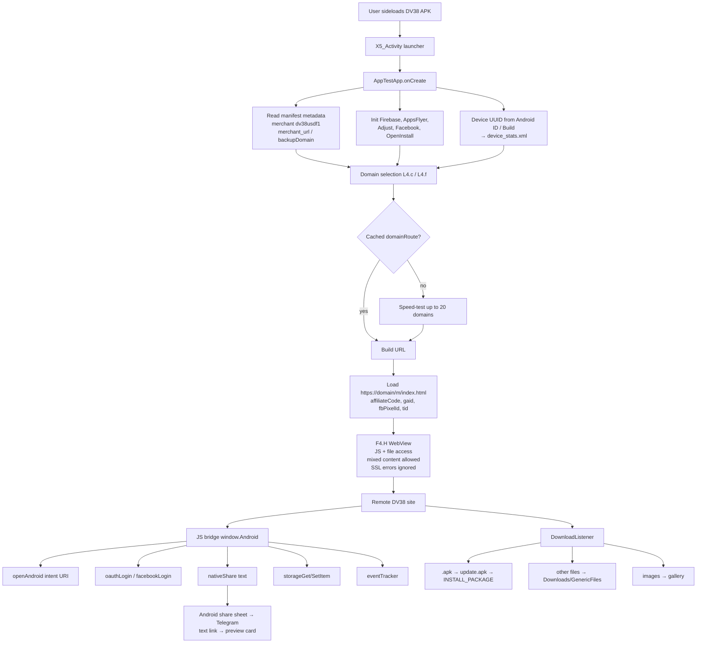
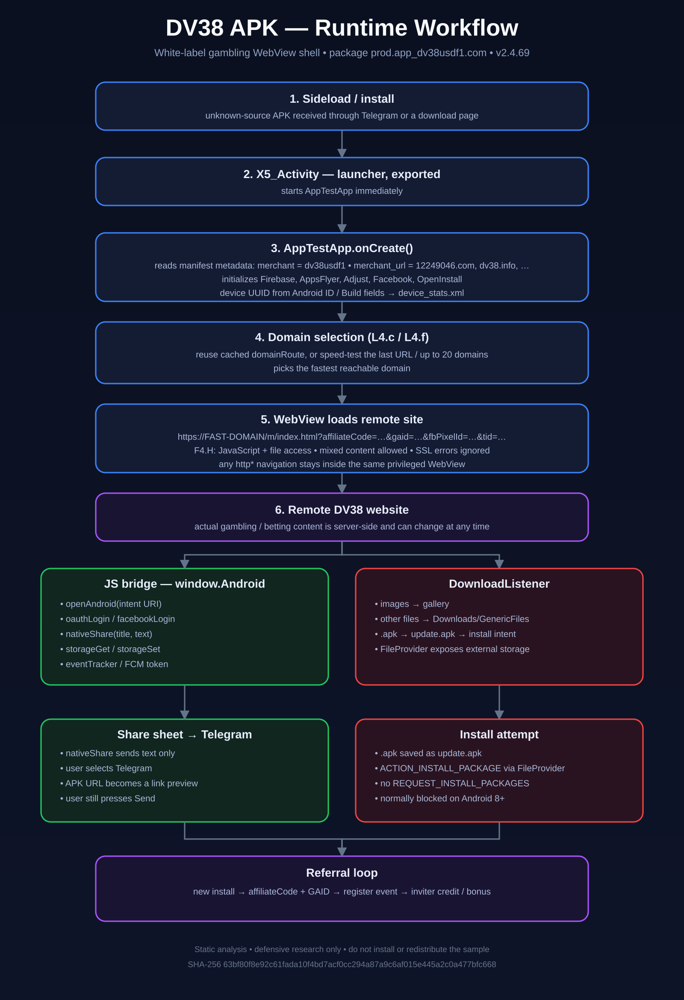
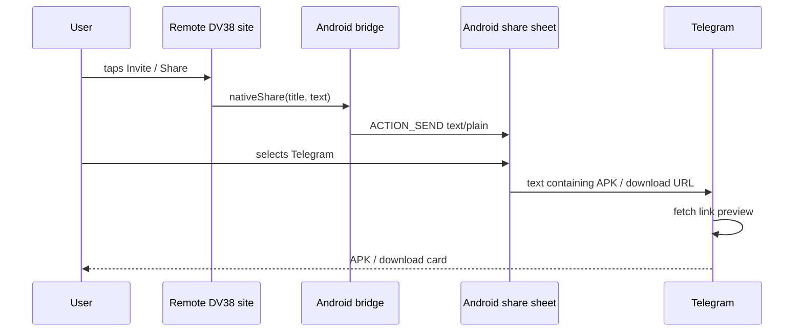

# China Scam App APK — DV38 Analysis

Static analysis of a sideloaded, white-label **gambling/scam WebView APK** distributed through Telegram invite links.

> ⚠️ **Defensive research only.** This repository documents malware/grayware behavior. Do **not** install the APK, do **not** share it, and do **not** use anything here to target people. The sample is **not** hosted here.

---

## Sample

| Field | Value |
|---|---|
| File | `dv38usdf1_2.4.69_20250926222217.apk` |
| Package | `prod.app_dv38usdf1.com` |
| Label | `DV38` |
| Version | `2.4.69` (versionCode 1, targetSdk 34, minSdk 23) |
| Size | ~4.8 MB |
| SHA-256 | `63bf80f8e92c61fada10f4bd7acf0cc294a87a9c6af015e445a2c0a477bfc668` |
| Cert SHA-256 | `6D:CD:C1:B1:7C:E0:83:ED:A1:75:47:49:76:FD:60:1F:AB:16:56:65:F8:76:2D:12:46:F6:47:F8:C9:F8:CB:AB` |
| Signer | `C=TW`, serial `23750b4e`, valid 2019–2044 |

**Verdict:** not a classic banking trojan, but **high-risk grayware / PUA** — a thin WebView shell for a remote gambling site, with domain rotation, aggressive tracking, disabled TLS validation, a powerful JavaScript bridge, and an APK download/install path.

---

## Repository contents

| Path | Description |
|---|---|
| [`docs/analysis.md`](docs/analysis.md) | Full static analysis: components, bridges, permissions, findings |
| [`docs/workflow.md`](docs/workflow.md) | Detailed runtime, Telegram share, and referral workflows |
| [`docs/workflow.svg`](docs/workflow.svg) | Visual workflow diagram |
| [`detection/iocs.json`](detection/iocs.json) | Machine-readable indicators |
| [`detection/dv38.yara`](detection/dv38.yara) | YARA rule for the APK |

---

## How it works (high level)





Rendered diagram: [`docs/workflow.png`](docs/workflow.png) · vector source: [`docs/workflow.svg`](docs/workflow.svg)

---

## Why it spreads through Telegram

The APK has **no Telegram integration** — no `org.telegram`, no `tg://` handler, no bot token, no `sendDocument`. The only share primitive is a text-only bridge:

```java
@JavascriptInterface
public void nativeShare(String title, String text) {
    Intent intent = new Intent();
    intent.setType("text/plain");
    intent.setAction("android.intent.action.SEND");
    intent.putExtra("android.intent.extra.TITLE", title);
    intent.putExtra("android.intent.extra.TEXT", text);
    startActivity(Intent.createChooser(intent, title));
}
```

The remote site calls this when the user taps **Invite / Share**. Telegram receives **text**; if that text contains an APK/download URL, Telegram renders a **file/document preview card**. That is why it looks like the app "sent a file".



The user still chooses the chat and presses **Send**. There is no silent self-replication.

---

## Key security findings

| Finding | Location | Risk |
|---|---|---|
| All TLS certificate errors ignored (`handler.proceed()`) | `F4.r.onReceivedSslError` | MITM |
| Mixed content always allowed (`setMixedContentMode(0)`) | `F4.H` | HTTP content in HTTPS |
| Cleartext traffic allowed | `AndroidManifest.xml` | MITM |
| `openAndroid()` parses arbitrary `intent://` URI | `prod.apptest.com.js.a` | Launch other apps / deep links |
| OAuth token returned to JS via `javascript:window.<cb>('...')` | `F4.H` | Token theft |
| Any `http*` URL stays in the privileged WebView | `F4.r` | Third-party page gets bridge access |
| FileProvider exposes whole external storage | `res/xml/file_paths.xml` | Broad file access |
| APK download → `ACTION_INSTALL_PACKAGE` | `F4.RunnableC0057h`, `E1.j` | Dropper path |
| Device UUID from Android ID / Build fields | `M4.d` | Fingerprinting |
| Advertising ID appended to URL | `L4.a.b()` | Tracking |
| AppsFlyer, Adjust, Facebook, Firebase, OpenInstall | multiple | Heavy tracking |

The install intent normally **fails on Android 8+** because the manifest does **not** declare `REQUEST_INSTALL_PACKAGES`.

**Not observed:** SMS/contact theft, accessibility abuse, overlays, device admin, root exploits, `DexClassLoader`, silent install, microphone/call recording.

---

## Indicators of compromise

```text
Package:  prod.app_dv38usdf1.com
SHA-256:  63bf80f8e92c61fada10f4bd7acf0cc294a87a9c6af015e445a2c0a477bfc668

Domains:
  12249046.com
  dv38.info
  dv38.dev
  dv38.pro
  dv38.blog
  www2.854819.com:42666      (backup / telemetry)
  www.gfbwff.com             (update check)

Template leftovers:
  sit-dayu88.com
  xyfenfa.vip
  datanetwork.cn

Firebase project: dv38usdf1-250727

Paths:
  <external-files>/update.apk
  Downloads/GenericFiles/
  SharedPreferences: device_stats.xml, JS_*, gaid_<merchant>
```

---

## Recommendations

- Do not install. If installed: uninstall, revoke permissions, scan the device.
- Never enter credentials, payment data, or personal documents into the app.
- Do not forward the APK or invite links.
- Report the Telegram message/account and the hosting domain.
- Verify the SHA-256 on VirusTotal before trusting any copy.

---

## License / use

Analysis is provided for defensive and educational purposes. Sample attribution and IOCs may be reused by defenders and researchers.
