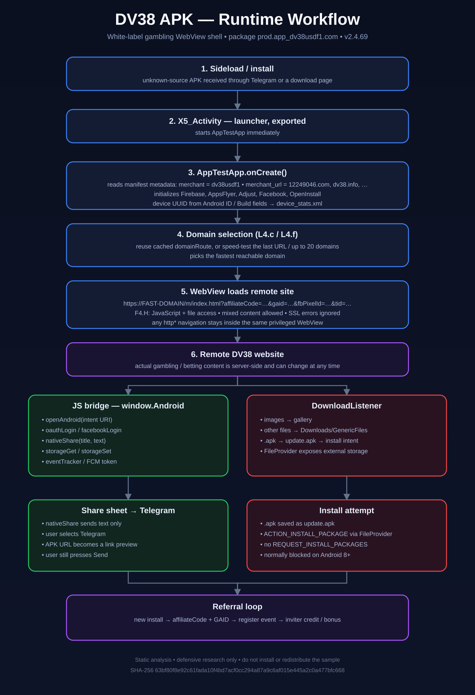
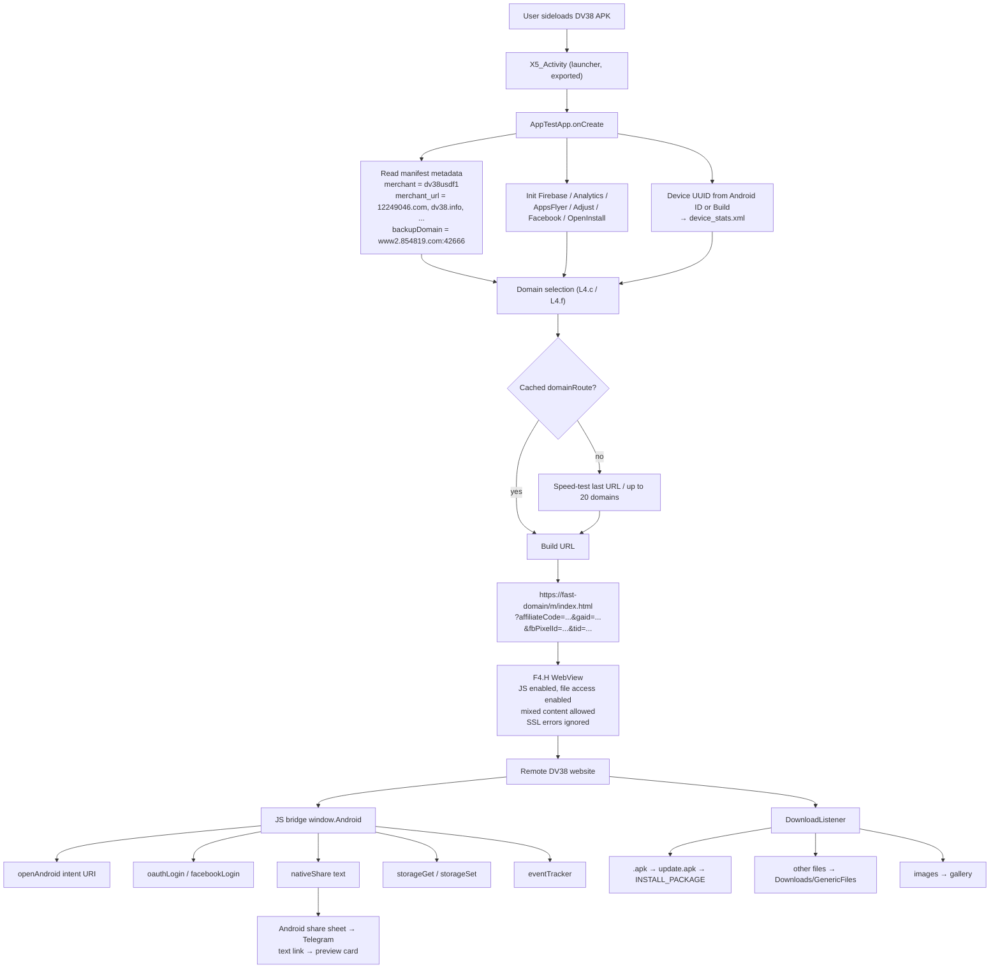
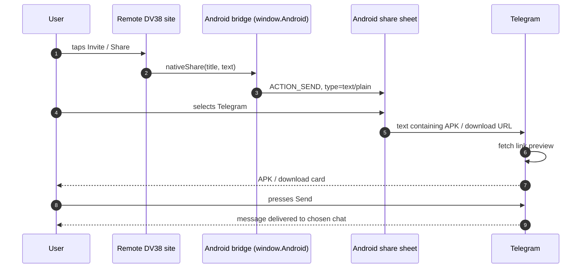
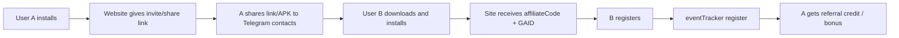
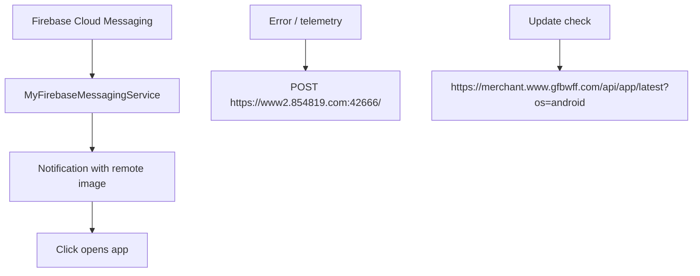
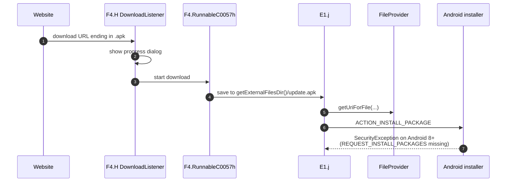

# DV38 — Runtime Workflow

This document describes what happens from install to Telegram sharing and referral credit.



---

## 1. End-to-end runtime



---

## 2. Step-by-step

### Step 1 — Install

The APK is sideloaded from a link or forwarded file. It is not distributed through Google Play. The manifest requests `INTERNET`, `READ_PHONE_STATE`, storage, camera, location, and notifications.

### Step 2 — Launcher

`X5_Activity` is exported and is the launcher entry point. It immediately initializes `AppTestApp`.

### Step 3 — Configuration

`AppTestApp` reads the merchant metadata from the manifest, starts the tracking SDKs, and generates a stable device identifier.

### Step 4 — Domain selection

`L4.c` / `L4.f` split the merchant URL list and either reuse a cached route or speed-test domains. The fastest reachable domain wins. This is domain rotation/failover.

### Step 5 — WebView

`F4.H` creates a permissive WebView:

- JavaScript on
- DOM storage on
- file access on
- mixed content always allowed
- SSL errors ignored
- any `http*` navigation kept inside the same WebView

### Step 6 — Remote content

The site at `/m/index.html` is the actual product (gambling/betting content). It receives the affiliate code, Google Advertising ID, Facebook pixel ID, and tracking ID.

### Step 7 — Native capabilities

The site can call `window.Android.*` to:

- open another URL in a privileged WebView
- launch arbitrary intents / deep links
- start Firebase/Facebook login and receive the token
- share text
- read/write app storage
- emit tracking events

### Step 8 — Downloads

The `DownloadListener` handles images, generic files, and `.apk` files. APK downloads go to `update.apk` and trigger an install intent via `FileProvider`.

---

## 3. Telegram share flow



### What the APK does

```java
@JavascriptInterface
public void nativeShare(String title, String text) {
    Intent intent = new Intent();
    intent.setType("text/plain");
    intent.setAction("android.intent.action.SEND");
    intent.putExtra("android.intent.extra.TITLE", title);
    intent.putExtra("android.intent.extra.TEXT", text);
    startActivity(Intent.createChooser(intent, title));
}
```

### What the APK does not do

- No `org.telegram` classes
- No `tg://` handler
- No `t.me` / `api.telegram.org`
- No bot token
- No `sendDocument`
- No `EXTRA_STREAM`
- No file attachment
- No silent send

The "file" appearance is Telegram's link preview for a URL that points to an APK or a download page.

`openAndroid(intentUri)` can launch `tg://` links, but the user still confirms.

---

## 4. Referral loop



This is a referral/viral loop, not self-replication. It relies on the user tapping Share, choosing Telegram, selecting contacts, and pressing Send.

---

## 5. Background components



---

## 6. Download and install flow



---

## 7. Timeline summary

| Phase | Action |
|---|---|
| T0 | User installs/sideloads APK |
| T1 | `X5_Activity` launches, `AppTestApp` reads config |
| T2 | Tracking SDKs initialize, device UUID generated |
| T3 | Domain speed-test / cached route selection |
| T4 | WebView loads remote site with tracking parameters |
| T5 | User interacts; site calls JS bridge as needed |
| T6 | User taps Invite → text shared to Telegram |
| T7 | Recipient installs and the loop repeats |
| T8 | Site may push APK update / install prompt |
